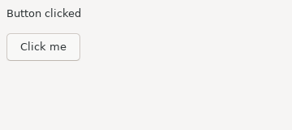
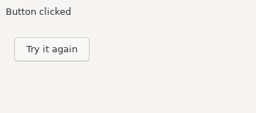

# App::Martha 0.002 regeneration check

The DC VM ran Ubuntu, system Perl 5.38.2, Wx 0.9932, wxGTK 3.2.4, and wxGlade 1.1.1 on an Xvfb display. The first Perl generation preceded the handwritten subclass. Each run used the same system Perl. An X11 mouse click on the displayed button produced the status below.

| | First run | Regenerated run |
| --- | --- | --- |
| Button caption | Click me | Try it again |
| Sizer border | 8 | 20 |
| Initial status | Ready | Ready |
| Status after click | Button clicked | Button clicked |




The second wxGlade GUI session reopened the same project. Automation edited the button through the designer property model and invoked the GUI's Save and Generate Code routines. The generated frame changed in these two lines, apart from the generator timestamp:

```diff
-    $self->{button} = Wx::Button->new($self->{panel}, wxID_ANY, "Click me");
-    $self->{layout}->Add($self->{button}, 0, wxALL, 8);
+    $self->{button} = Wx::Button->new($self->{panel}, wxID_ANY, "Try it again");
+    $self->{layout}->Add($self->{button}, 0, wxALL, 20);
```

SHA-256 of the complete handwritten `app.pl`, before and after regeneration:
`8acd0dd2120155bb8296aa8b89acb245b4e5348c36bf64efbc780b05b13b8fb1`.

The shipped starter uses the first layout so the exercise can be repeated.
